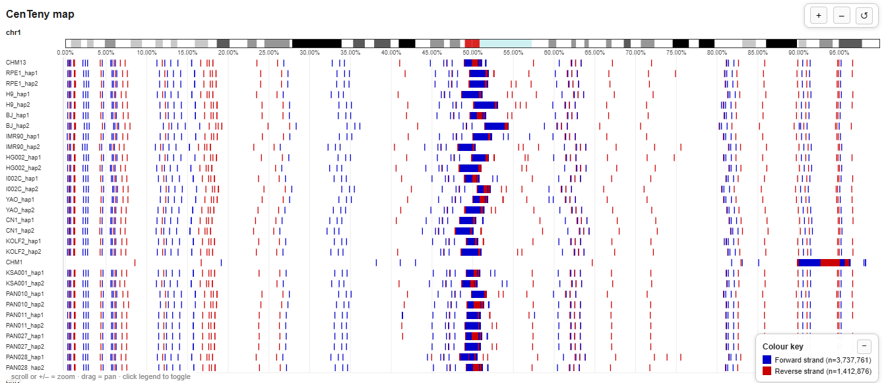
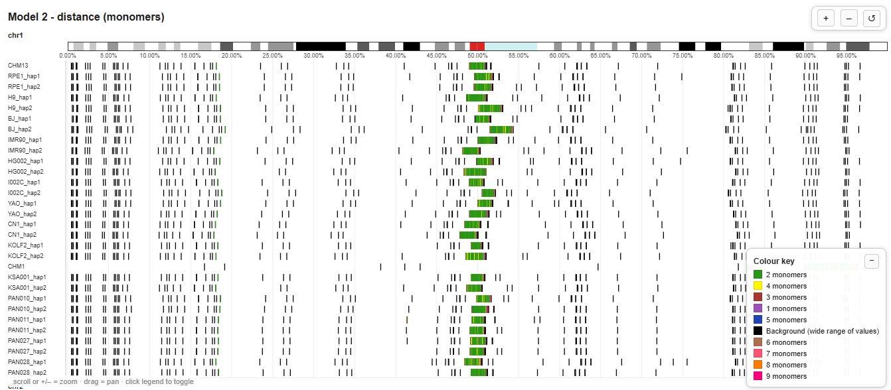
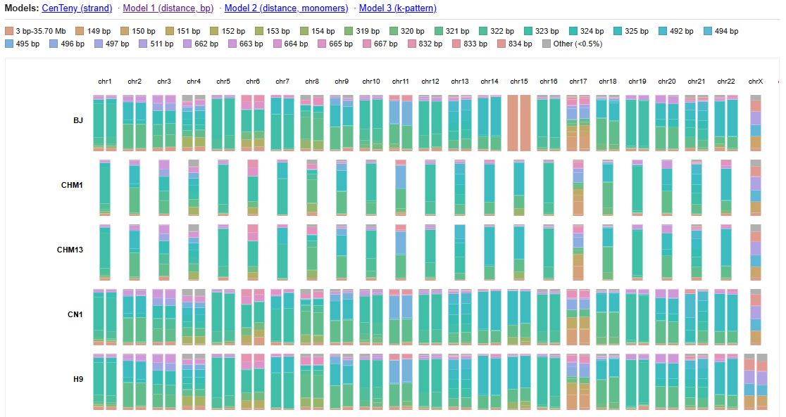

# Centeny Plot Tool (CPT)

> **Fork note.** This is a customised fork of
> [GiuntaLab/centeny-plot-tool](https://github.com/GiuntaLab/centeny-plot-tool).
> Changes are limited to the optional clustering analysis and are listed in
> [Fork changes](#fork-changes); with default options the tool behaves like upstream.

A karyotype-style visualization pipeline for centromeric/CENP-B motif annotation
data across one or many genome assemblies. Renders stacked feature tracks
against a chromosome ideogram, colour-codes features by category, and produces
both static and interactive html outputs.

---

## Contents

- [What it does](#what-it-does)
- [Installation](#installation)
- [Quick demo](#quick-demo)
- [Input files](#input-files)
- [Running it](#running-it)
- [Output files](#output-files)
- [Coordinate modes: bp vs percent](#coordinate-modes-bp-vs-percent)
- [Optional clustering analysis](#optional-clustering-analysis)
- [Full CLI reference](#full-cli-reference)
- [Running via Snakemake](#running-via-snakemake)
- [Motif model composition report](#motif-model-composition-report)
- [Examples](#examples)
- [Troubleshooting](#troubleshooting)
- [Citations](#citations)

---

## What it does

For each sample in a sample sheet, CPT reads a BED9-format annotation file,
groups samples by which "model" they represent, and draws one karyotype
figure per model: every chromosome stacked vertically, one horizontal track
per sample, features drawn as coloured tick marks against a cytoband
ideogram. A colour legend explains what each colour means, sized and grouped
appropriately for the model.

---

## Installation

Clone and set up environment:

```bash
git clone https://github.com/GiuntaLab/centeny-plot-tool.git
cd centeny-plot-tool
conda env create -f envs/centeny_r.yaml
conda activate centeny_plot
```

`envs/centeny_r.yaml`:
```yaml
name: centeny_plot
channels: [conda-forge, bioconda, defaults]
dependencies:
  - r-base=4.3
  - r-data.table
  - r-optparse
  - bioconductor-karyoploter
```

---

## Quick demo

A runnable, fully self-contained demo is included in `test/` which includes the
haplotypes (`RPE1_hap1`, `RPE1_hap2`) [`GCP-Centeny`](https://github.com/GiuntaLab/GCP-Centeny) output.

Run it (from the directory containing `test/` and `scripts/`):

```bash
Rscript scripts/centeny_plot_tool.R \
  --cytoband      test/cytoband.bed \
  --sample_sheet  test/samples.tsv \
  --output        demo_output/centeny_plot
```

This produces, in `demo_output/`:
```
centeny_plot_centeny.html   centeny_plot_centeny_metrics.tsv   centeny_plot_centeny_cross_sample_summary.tsv
centeny_plot_model1.html    centeny_plot_model1_metrics.tsv    centeny_plot_model1_cross_sample_summary.tsv
centeny_plot_model2.html    centeny_plot_model2_metrics.tsv    centeny_plot_model2_cross_sample_summary.tsv
centeny_plot_model3.html    centeny_plot_model3_metrics.tsv    centeny_plot_model3_cross_sample_summary.tsv
```

**Single chromosome only**:
```bash
Rscript scripts/centeny_plot_tool.R \
  --cytoband test/cytoband.bed \
  --sample_sheet test/samples.tsv \
  --output demo_single_chr/centeny_plot \
  --chromosome 7
```

**Try percent coordinate mode and optional clustering analysis with downsampling instead**:

```bash
Rscript scripts/centeny_plot_tool.R \
  --cytoband test/cytoband.bed \
  --sample_sheet test/samples.tsv \
  --output demo_output_pct/centeny_plot \
  --coord_mode percent \
  --genome_sizes test/genome_sizes.tsv \
  --cluster true \
  --html_max_points 1000000
```

**Motif clustering and motif karyotpye-like plot**:

```bash
Rscript scripts/motif_report.R \
  --sample_sheet test/samples.tsv \
  --output demo_output_motif/motif_report
```

---

## Input files

### Sample sheet
Tab-separated, **no header**, 2 or 3 columns:
```
<label>	<path_to_bed>	[<model>]
```
- `<label>` — sample name, shown as the track label. Can repeat across rows
  (e.g. the same label for its centeny/model1/model2/model3 rows) — the
  script keys data internally by row, not by label.
- `<model>` is optional: `centeny` | `model1` | `model2` | `model3` | `auto`
  (default if omitted). Rows of different models can be freely mixed in one
  file.

### Cytoband file
Any BED-like file with **≥5 tab-separated columns**:
```
<chr>	<start>	<end>	<band_name>	<gieStain>
```
This single file defines **the entire genome** for the plot — chromosome
list and lengths are derived directly from it (max `end` per chromosome).
Works with any species: human CHM13, any great-ape assembly (chr23/24 and
all).

### Genome sizes file (only for `--coord_mode percent`)
Tab-separated, no header, 2 columns:
```
<sample_label>	<path_to_fai>
```
One row per **distinct** label used in the sample sheet (a label repeated
across model rows only needs one entry — same physical genome).
`<path_to_fai>` is a [`samtools faidx`](http://www.htslib.org/doc/samtools-faidx.html)
index of that sample's own FASTA:
```bash
samtools faidx my_assembly.fasta   # creates my_assembly.fasta.fai
```

---

## Running it

Minimal invocation (produces the interactive html by default):
```bash
Rscript scripts/centeny_plot_tool.R \
  --cytoband     cytoband.bed \
  --sample_sheet samples.tsv \
  --output       my_run/centeny_plot
```

Downsampling, percent mode and clustering:
```bash
Rscript scripts/centeny_plot_tool.R \
  --cytoband cytoband.bed \
  --sample_sheet samples.tsv \
  --output my_run/centeny_plot \
  --coord_mode percent \
  --html_max_points 1000000 \
  --genome_sizes genome_sizes.tsv \
  --cluster true 
```

Single chromosome only:
```bash
Rscript scripts/centeny_plot_tool.R \
  --cytoband cytoband.bed \
  --sample_sheet samples.tsv \
  --output my_run/centeny_plot \
  --chromosome 7
```

---

## Output files

Per model group present in the sample sheet (`<group>` = `centeny` |
`model1` | `model2` | `model3`):

| File | Produced when |
|---|---|
| `<output>_<group>.html` | `--format html` (default), or `--html true` with any `--format` |
| `<output>_<group>.<fmt>` | `--format` is `pdf`/`tiff`/`png`/`svg` |
| `<output>_<group>_metrics.tsv` | always |
| `<output>_<group>_cross_sample_summary.tsv` | always |
| `<output>_<group>_clustering.pdf` / `.html` | `--cluster true` |

`_metrics.tsv` — one row per sample × chromosome: block count, total
feature length, centromere span/midpoint, chromosome length, relative
position, dominant colour, colour diversity.

`_cross_sample_summary.tsv` — per chromosome, mean/SD/CV of centromere
midpoint position and feature counts across all samples in the group.

---

## Coordinate modes: bp vs percent

**`--coord_mode bp`** (default) — real genomic coordinates. Correct and
sufficient whenever every sample in the run shares the same reference
assembly.

**`--coord_mode percent`** — every chromosome rescaled to 0–100% of its own
length, using **each sample's own** chromosome length (from
`--genome_sizes`), not the shared cytoband file's length. 

The cytoband ideogram bar itself always uses the shared `--cytoband` file's
length either way for reference purposes.

---

## Optional clustering analysis

`--cluster true` adds, per model group, a chromosome-similarity analysis:
for every sample × chromosome, tabulates the proportion of features in each
colour/category, then hierarchically clusters (**Euclidean distance**,
**average-linkage/UPGMA**) to reveal which chromosomes, within a sample and
across different samples, share similar feature composition.

Outputs both a static heatmap+dendrogram (`_clustering.pdf`) and an interactive version
(`_clustering.html`). Non-informative categories (background/catch-all buckets, "+N more"
overflow) are excluded from the analysis to focalize clustering.

### Fork changes

- Features whose colour is missing from the merged legend are dropped before
  computing proportions. Upstream, a row left with no valid feature produced
  `0/0 = NaN` and `hclust` stopped with an error.
- `--cluster_level genome` clusters whole samples instead of sample × chromosome:
  one row per sample, with the profile computed over all its chromosomes.
  `--genome_profile pooled` (default) sums the counts of all chromosomes, so each
  chromosome weighs as much as its number of features; `mean` averages the
  per-chromosome profiles with equal weight. Output files get a `_genome` suffix.
- `--cluster_min_boxes N` drops sample × chromosome units with `<= N` informative
  features; `--cluster_exclude X,Y` leaves chromosomes out; `--cluster_method`
  sets the `hclust` linkage (default `average`).
- The clustering also writes `<output>_clustering_units.tsv`: informative features
  per sample and chromosome, and whether each unit was used.

---

## Full CLI reference

| Flag | Default | Description |
|---|---|---|
| `--workdir` | current dir | Working directory |
| `--cytoband` | *(required)* | Cytoband BED file — defines the whole genome |
| `--sample_sheet` | *(required)* | Sample sheet TSV |
| `--output` | `centeny_plot.tiff` | Output base name; `_<group>` and extension appended automatically |
| `--chromosome` | all | Plot only one chromosome (e.g. `7`, `X`) |
| `--format` | `html` | `html` \| `tiff` \| `png` \| `svg` \| `pdf`. `html` = interactive viewer only |
| `--html` | `false` | Also write the interactive HTML alongside a non-html `--format` |
| `--html_max_points` | `150000` | Cap on rendered features in the HTML; `0` = unlimited |
| `--plot_width` / `--plot_height` | `7.5` / `18.0` | Inches, svg/pdf only |
| `--jpeg_res` / `--jpeg_width` / `--jpeg_height` | `1200` / `9000` / `21600` | PNG only |
| `--chr_cex` | `0.8` | Chromosome label font size |
| `--label_cex` | `0.65` | Sample track label font size |
| `--tick_cex` | `0.5` | Genomic coordinate axis number font size |
| `--track_height` / `--track_gap` | `1.5` / `5.0` | Sample track sizing |
| `--major_tick` / `--minor_tick` | `10000000` / `5000000` | Axis tick intervals (bp) |
| `--ideogram_gap` | `15` | Gap between ideogram and feature track(s) |
| `--model` | `auto` | Force model for all rows without an explicit sample-sheet tag |
| `--top_n_patterns` | `10` | Model 3: how many k-patterns get their own colour (rest → "Other") |
| `--legend_cex` | `0.6` | Legend font size |
| `--legend_max_entries` | `30` | Cap legend rows; excess folds into "+N more" |
| `--coord_mode` | `bp` | `bp` \| `percent` (percent requires `--genome_sizes`) |
| `--genome_sizes` | — | Required for percent mode; see [Input files](#input-files) |
| `--cluster` | `false` | Run the optional clustering analysis |
| `--cluster_level` | `chromosome` | *(fork)* `chromosome` \| `genome` — clustering unit |
| `--genome_profile` | `pooled` | *(fork)* `pooled` \| `mean` — how chromosomes are combined with `--cluster_level genome` |
| `--cluster_min_boxes` | `0` | *(fork)* Drop units with `<= N` informative features |
| `--cluster_exclude` | — | *(fork)* Comma-separated chromosomes left out of the clustering |
| `--cluster_method` | `average` | *(fork)* `hclust` linkage method |

Run `Rscript scripts/centeny_plot_tool.R --help` at any time for this same list

---

## Running via Snakemake

```bash
snakemake --cores 1
```

All options above are also settable in `config.yaml` (same names, e.g.
`coord_mode: "percent"`, `cluster: "true"`). See `config.yaml` for the full,
commented list of defaults.

---

## Motif model composition report

A companion script that reuses the **same sample sheet** as the main pipeline and needs no additional input.

```bash
Rscript scripts/motif_report.R \
  --sample_sheet samples.tsv \
  --output       my_run/motif_report
```

Produces two outputs:

- **`whole_genome_motif_abundance.html`**: one stacked bar per *sample*
  (haplotypes shown separately, never merged), one chart per model, each
  bar summing to 100% and broken down by that model's own categories.

- **`<output>_karyotypes.html`**: a karyotype-style grid per model.
  Also includes, per model, a collapsible Euclidean-distance / average-linkage (UPGMA) clustering dendrogram +
  heatmap showing which *samples* have the most similar category composition.

Key options: `--composition_threshold` (default `0.5`, folds categories
below this % of a model's global total into "Other") and
`--kpattern_top_n` (default `10`, model 3's number of individually-coloured
k-patterns before folding the rest into "Other").

Try it against the demo data:
```bash
Rscript scripts/motif_report.R \
  --sample_sheet test/samples.tsv \
  --output demo_output_motif/motif_report
```

---

## Examples

The Centeny Plot Tool (CPT) is designed to enable easier visualizing of the CENP-B motifs across multiple references at once. Here were present
snapshots of the CPT output html files as run on a set of T2T references:

**(a) Centeny map interactive plot**



**(b) Model 2 interactive plot**



**(c) Model 1 per-chromosome motif abundance's interactive plot**



---

## Troubleshooting

**Sparse regions "disappear" in the HTML** — increase `--html_max_points`,
or set it to `0` for no downsampling at all. Even with the cap active,
downsampling is spatially binned so sparse regions are preserved far better
than a naive random subsample would.

**Legend has a lot of "+N more" or "Other"** — raise `--legend_max_entries`
(models 1/2/3) — categories below a natural abundance threshold are folded
in by design to keep the legend readable.

---

## Citations

If you use this tool, please kindly remember to cite our GitHub as well as the GCP-Centeny pipeline and the T2T CHM13v2.0 assembly, since their output are used:

- Nurk et al. (2022) The complete sequence of a human genome. *Science* 376.6588.
- Corda and Giunta (2025) Chromosome-specific centromeric patterns define the centeny map of the human genome. *Science* 389.6755.
